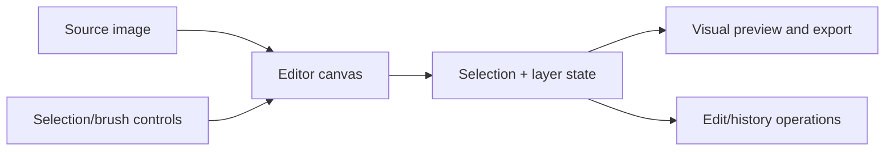

# V3 CANVAS · IMAGE EDITOR

### Selection is a data structure, not a moving outline.

**Visual authoring · reproducible masks · editable canvas state**

Image editing becomes difficult to verify when tools only change the displayed pixels. A serious editor should preserve the selected region, its tolerances, the layer it belongs to and the operation that produced it.

**V3 CANVAS · IMAGE EDITOR** is an experimental source project investigating this workflow. A layered browser image-editor research app with a magic-wand tool, segmentation options, selection and layer state, undo/redo history, properties inspector and a performance overlay. The checked-in source uses canvas editing rather than a finished production imaging SDK.

> **Implementation boundary:** the components are present in the Git repository. The application was **not newly built or rendered** during this documentation pass. Feature presence, a working UI and independently measured selection quality are three different evidence levels.

**Source:** [ImageEditor.tsx](src/components/editor/ImageEditor.tsx) · [EditorCanvas.tsx](src/components/editor/EditorCanvas.tsx) · [WandSettingsDrawer.tsx](src/components/editor/WandSettingsDrawer.tsx) · [PerformanceOverlay.tsx](src/components/editor/PerformanceOverlay.tsx)

---

## What this repository contains



| Responsibility | Current source direction |
|---|---|
| **Canvas** | Browser image pixels, pointer input and editor transforms |
| **Selections** | Magic-wand and/or lasso interactions with explicit parameter controls |
| **Layers** | Independent compositing and visibility state |
| **History** | Undo/replay metadata where implemented by the editor |
| **Visualization** | Editor panels and user feedback, not an independent accuracy certificate |

## Start from source

```bash
npm install
npm run dev
```

This is a Vite-based React app; use the local URL printed by the server. A successful bundler run is not evidence that every editing gesture or integration works.

## Qualification work

The tool should be checked against labeled reference masks, alpha boundaries, contiguous and noncontiguous selections, image sizes, and history replay. A fast visual interaction does not establish mathematically exact region segmentation.

**The goal is an editor whose operations can be inspected and reversed, not merely a UI whose effects seem plausible.**

---

*The boilerplate README has been replaced with source-specific documentation. No editor source files were changed.*
